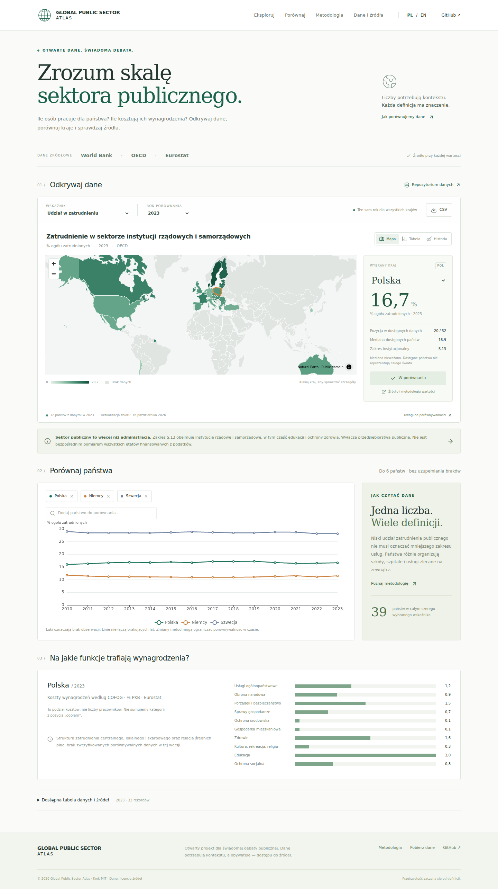

# Global Public Sector Atlas

Open-source, dwujęzyczny atlas skali sektora publicznego. Astro + React + TypeScript + Tailwind CSS + Apache ECharts + MapLibre; ETL w Pythonie z Polars i Pydantic.

**MVP korzysta z rzeczywistych danych OECD, World Bank WWBI/WDI i Eurostatu.** Nie utożsamia administracji z całym sektorem publicznym ani własności państwowej z finansowaniem podatkowym. WWBI jest oddzielnym, opisowym widokiem o zmiennym zakresie.



## Uruchomienie

Wymagane Node.js 22.12+ i Python 3.12.

```bash
npm ci
python3 -m venv .venv
. .venv/bin/activate
pip install -r requirements.txt
python -m etl.pipeline
npm run dev
```

Otwórz `http://localhost:4321/pl/` lub `/en/`.

```bash
python -m pytest -q
npm run check
npm run build
npx playwright install chromium
npm run test:e2e
```

Build jest statyczny (`dist/`) i nie wymaga działających API. Odświeżenie z sieci: `python -m etl.pipeline --refresh`. Przed publikacją przejrzyj różnice definicji, pokrycia i rewizji. Dane zaktualizowane automatycznie trafiają do osobnej gałęzi; podsumowanie workflow zawiera link do otwarcia PR.

## Dostępne funkcje

- Mapa świata, ranking dla jednolitego zakresu S.13, wspólny rok i jawne braki.
- Udział w zatrudnieniu, osoby na 1000 mieszkańców, koszty wynagrodzeń jako % PKB.
- Opisowe dane WWBI (bez rankingu); porównanie do 6 krajów i serie historyczne.
- Koszty wynagrodzeń według 10 funkcji COFOG; nie jest to struktura zatrudnienia.
- Ślad źródłowy, raw snapshoty, JSON/CSV, pobieranie bieżącego widoku.
- PL/EN, statyczne profile krajów, metadane SEO, sitemap.

**Świadome ograniczenia:** ILOSTAT i krajowe API są rozpoznane, lecz jeszcze nie zintegrowane. Brak zweryfikowanego globalnego podziału zatrudnienia według instytucji i porównywalnej relacji średnich płac publicznych do prywatnych. Nie zastępujemy tych braków danymi przykładowymi. Dane OECD pochodzą z edycji 2025; synchronizacja odświeża tę edycję, migracja do kolejnej wymaga przeglądu.

## Projekt i dane

- [Architektura, model i plan rozwoju](docs/architecture.md)
- [Schemat JSON](data/observation.schema.json)
- [Dane według kraju/roku/wskaźnika](data/observations)
- [Pełny CSV](public/data/observations.csv) / [JSON](public/data/observations.json)
- [Katalog i źródła](public/data/catalog.json)
- [Wdrożenie Cloudflare Pages](docs/deployment.md)
- [Licencje danych](DATA-LICENSES.md)

Każda obserwacja zawiera definicję, metodę, jednostkę, źródło, rok, datę pobrania i hash surowych danych. Wartości obliczone wskazują wejścia. Dane są wersjonowane wraz z kodem; kod MIT, dane na licencjach dostawców.

## Współtworzenie

Zgłaszając błąd danych, podaj ID obserwacji, dokładny URL, tabelę/stronę oraz definicję i rok. Nowy adapter musi mieć próbkę raw, mapowanie jednostek, reguły zakresu, licencję i testy. Zmiana definicji wymaga nowej wersji schematu lub nowego wskaźnika, nie cichego zastąpienia szeregu.
