# Architektura i zakres MVP

## Decyzja

Astro generuje statyczny HTML dla PL/EN, metodologii, źródeł i profili krajów. React odpowiada za interakcje, Apache ECharts za wykresy, MapLibre za mapę bez zewnętrznych kafelków. Tailwind 4 działa przez Vite, własne tokeny CSS odpowiadają za spójność wizualną. Natural Earth jest hostowany lokalnie. Żadne API statystyczne nie jest wywoływane przez przeglądarkę. Nie ma kont, backendu ani bazy serwerowej.

```mermaid
flowchart LR
  API[OECD / Eurostat / World Bank] --> RAW[Surowe snapshoty + SHA-256]
  RAW --> ETL[Python + Polars]
  ETL --> VALID[Pydantic + testy + kontrola zakresu]
  VALID --> JSON[JSON kraj / rok / wskaźnik]
  JSON --> EXPORT[CSV + JSON + katalog + metadane]
  EXPORT --> ASTRO[Astro: HTML PL/EN]
  ASTRO --> CF[Cloudflare Pages / CDN]
  CF --> UI[React / ECharts / MapLibre]
```

## Kontrakt danych

Pydantic jest źródłem prawdy: `etl/schema.py`, wygenerowany `data/observation.schema.json`. Tożsamość v1: kraj ISO3, rok, wskaźnik, funkcja. Każdy wskaźnik ma w v1 jedno wybrane źródło; nie scala się konkurencyjnych obserwacji. Wprowadzenie wielu źródeł tego samego wskaźnika wymaga migracji ID i jawnej selekcji źródła, a nie nadpisania.

Rekord ma wartość lub `null`, jednostkę, populację/mianownik, podstawę zatrudnienia, zakres, grupę porównywalności, status, flagi, źródło URL, definicję, metodę, czas pobrania, SHA-256 i wejściowe ID. Dla wartości wyliczonej hash wskazuje surowy licznik, a `input_ids` wskazują kompletne metadane licznika i mianownika. Łańcuch źródeł jest weryfikowany.

`data/observations/POL/2023/government_employment_share.json` zawiera kanoniczny rekord. `public/data/observations.{json,csv}` to pełne eksporty. `public/data/atlas.json` jest lekkim indeksem UI; `public/data/countries/POL.json` ładuje pełne metadane na żądanie. Data/rok pobrania to nie rok obserwacji.

Brak rekordu oznacza brak obserwacji w zaimportowanym zakresie, a nie dowód nieistnienia danych u dostawcy. Puste komórki Eurostatu zachowujemy jako `status=missing`, `missing_reason=not_reported`. Ani zera, ani interpolacja nie zastępują braków.

## Zasady agregacji

- General government S.13 oddzielony od administracji i własności publicznej.
- Japonia w OECD wyłącza fundusze zabezpieczenia społecznego: osobny zakres, wyłączona z mapy porównawczej, rankingu i mediany. Rekordy pozostają dostępne w profilu i eksporcie.
- WWBI ma niezweryfikowany na poziomie obserwacji zakres mikrobadania. Widok opisowy bez rankingu/mediany, grupy porównywalności per kraj. Wykresy nie dowodzą porównywalności trendu; trzeba sprawdzić badanie.
- OECD i UE jako agregaty nie są krajami i nie występują w rankingu.
- Wszystkie wartości porównania mają ten sam rok. Brak dla Norwegii w 2023 nie jest zastępowany rokiem 2022.
- Per 1000: OECD osoby (PS, mnożnik 3) / WDI populacja tego samego roku × 1000. Nie mylić osób i FTE.
- D.1 obejmuje płace i składki pracodawcy. COFOG poziomu 1 pokazuje koszty funkcji, a nie zatrudnienie. TOTAL nie jest dodawane do składowych.
- Surowy iloraz płac i skorygowana premia regresyjna pozostają różnymi wskaźnikami.

## Automatyzacja

`sync-data.yml`: w poniedziałki 05:23 UTC (07:23 Europe/Warsaw latem, 06:23 zimą), retry/backoff, paginacja WWBI `skip`, walidacja, przeliczenie, PR do przeglądu. Nie ma automatycznego merge. Błąd API przerywa aktualizację; wersja opublikowana pozostaje dostępna. Snapshoty i metadane są wersjonowane w Git.

`ci.yml`: odtworzenie z zamrożonych danych, testy Python, kontrola diff, TypeScript/Astro, build, Playwright, artifact statyczny. Main może być wdrażany na Pages, jeśli repo ma dwa sekrety Cloudflare. PR nie dostaje sekretów wdrożeniowych.

## Globalna skala i dalsze etapy

W MVP JSON ma kilkanaście MB i mieści się w statycznym hostingu. Indeks UI to ok. 2 MB przed kompresją; pełne metadane pobierane per kraj. Rozszerzenie o wiele tysięcy serii powinno rozbić indeks wg wskaźnika i zakresu oraz generować manifest shardów z hashami. Zachować czytelny CSV/JSON; Parquet można dodać jako dodatkowy eksport analityczny. Nie wprowadzać bazy serwerowej bez rzeczywistej potrzeby.

Następne integracje:
1. ILOSTAT: `EMP_TEMP_SEX_INS_NB_A`, SEX_T, INS_SECTOR_PUB, tysiące osób; rozwiązać `source`, `note_source`, zakres SOE, typ badania, osoby/FTE i przerwy. Nie sumować wielu źródeł w jednym roku.
2. GUS/ONS/INSEE/Destatis i raporty budżetowe: stabilny URL, data publikacji, strona/tabela, jednostki instytucjonalne, państwowe przedsiębiorstwa oddzielnie. Ręczne ekstrakcje oznaczać i poddawać przeglądowi dwóch osób.
3. Podział zatrudnienia: zaprojektować osobne wymiary szczebla administracji, funkcji COFOG i rodzaju instytucji. Są to przekroje krzyżowe, nie jedna sumowalna lista.
4. Płace: osobne średnie/medianowe brutto, godzinowe/miesięczne, waluta, PPP/rok bazowy, populacja porównania oraz osobna premia skorygowana z modelem i kontrolami. Nie wprowadzać do rankingu wskaźnika o niepotwierdzonej jednostce.
5. Finansowanie z podatków: wymaga dodatkowych danych o źródle finansowania, konsolidacji i outsourcingu. S.13 pozostaje przybliżeniem instytucjonalnym, nie etykietą „wszyscy opłacani z podatków”.

## SEO i dostępność

`/pl/`, `/en/`, profile krajów, canonical, hreflang, sitemap i robots. HTML zawiera treść niezależną od JavaScript. Tabela i CSV są alternatywą dla mapy/WebGL, wykresy mają opis tekstowy, kontrolki etykiety i focus, dialog obsługuje Escape oraz pułapkę fokusu. Brak zewnętrznych fontów, analityki i kluczy map.
